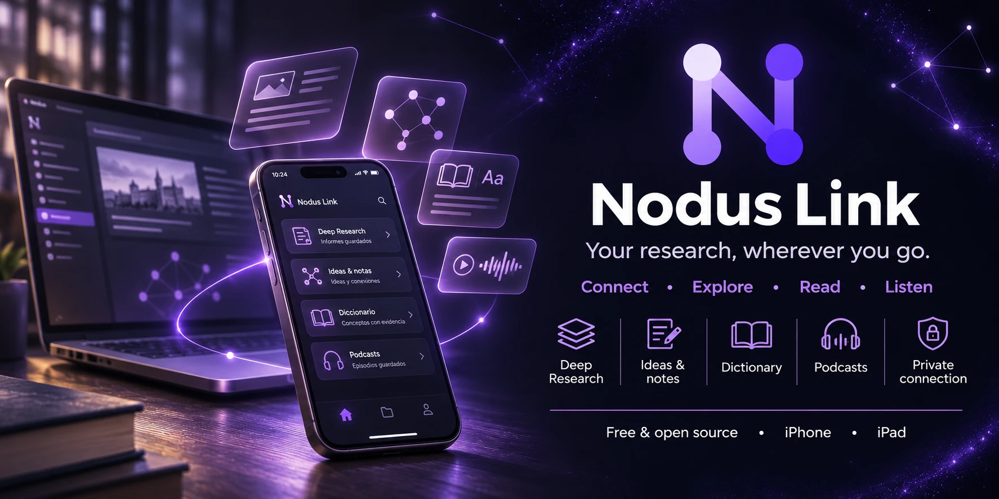

<p align="center">
  
</p>

> **Nodus Link 0.1.0:** the first iOS/iPadOS release now focuses on reading your
> linked academic Desktop research and listening to saved podcasts. Other vault types
> are retained in code but hidden in this version. Creation, editing and
> generation are retained in code but disabled for this release. The earlier full
> parity notes below are historical scope, not a release certification. See
> [the current scope](docs/mobile-0.1.0/nodus-link-2026-11-13.md).

# Nodus Mobile

iPhone and iPad companion for [Nodus](https://github.com/jorgepb96/nodus), one directory per platform.

The initial Nodus Link internal beta was **0.1.0 (1005)**, verified as available in
TestFlight on 14 November 2026. The interface candidate in this PR is **0.1.0 (1006)**.
Use Nodus Desktop **5.18.0** or later.
The interface revision is described in the [mobile design record](docs/mobile-0.1.0/interface-2026-11-14.md).
Check PR #30 for the candidate’s current validation and TestFlight status.
See the [current delivery and connection notes](docs/mobile-0.1.0/delivery-2026-11-14.md).
The earlier [delivery record](docs/mobile-0.1.0/TESTFLIGHT-2026-10-15.md) and
[implementation record](docs/mobile-0.1.0/IMPLEMENTATION-2026-10-15.md) are historical.

```
ios/          iOS and iPadOS app (SwiftUI), its Swift packages and its tools
```

Android has no directory yet. When it gets one it sits beside `ios/`, and nothing above this line
should have to change for it.

## Companion connection

Open Desktop **Settings → Application → Mobile connection** and link the complete workspace
with a temporary QR, code or link. Direct HTTPS on the same LAN or local VPN is the enabled
connection in 0.1.0. Server/Cloud onboarding and iCloud content synchronization are hidden.

**Desktop 5.18.0 workaround:** the Mobile connection section was omitted from the grouped
settings menu. Search settings for **Mobile connection** (or **Conexión móvil**) to open it.
[Desktop PR #1355](https://github.com/jorgepb96/nodus/pull/1355) restores its Application tab
and adds **Nodus Link**, **iOS**, **iPad**, **iPadOS**, and **Android** search aliases.
Those additional aliases require a desktop build containing that fix; Android is a search
alias, not a supported mobile platform.

## Historical implementation notes

The remaining implementation notes describe the earlier, broader parity project. In the
0.1.0 Link release, editing, AI/audio generation, autonomous providers and edit synchronization
remain in code but are disabled. They are not features of the delivered consultation beta.

Live mode uses the Mac's effective models and providers; their credentials remain on the Mac.
Autonomous mode uses providers explicitly configured on the device. The app never switches modes
automatically. Extraction, indexing and derived-idea pipelines stay on Desktop.

SwiftUI navigation hosts shared Nodus graph, argument-map, research, dictionary and BlockNote
surfaces. Selected Scriptor documents use encrypted temporary downloads with a shared 250 MiB
read budget per Mac. Pending structured edits and new authored notes/ideas survive app restart
and temporary-copy cleanup. Reconnection sends immutable saves; revision conflicts require an
explicit choice.

The current implementation extends selected downloads to research reports, dictionary entries
and immersions, with saved translations, annotations, decorative images and citation previews.
Dictionary copies include local filters, complete paginated evidence and versions. Independent
selections are combined. Originals, attachments and recordings can be retained separately for
7 or 30 days and reopened from device storage. These additions await the final build and
acceptance campaign; other-domain catalogues and the complete release gate remain pending.
Open file previews also share a bounded transient budget and release their temporary plaintext
files when the last reader closes. Pending Mac requests reuse their original identities after
reconnection; portable result saves synchronize in either mode, while queued Mac generation
requires live to remain selected. Failed or interrupted generations are not restarted automatically.
Completed dictionary definitions, translations, immersions and writing assistance retain an
encrypted result together with their immutable publication request. They remain consultable in
Settings → Jobs and results while awaiting the Mac. Transport loss preserves the saved state;
source conflicts and provider failures remain explicit errors. Reconnection reconciles the
original checkpoint with the Mac acknowledgement without regenerating the response. This new
recovery path also awaits compilation and the deferred acceptance campaign.
Companion-authored ideas retain their owning note and remain visible in Desktop's automatic
academic catalogue and graph. A linked corpus revision refreshes mounted graph, dictionary,
research and Scriptor catalogues without replacing the web view or editor. Graph source and
background caches are invalidated together; saved camera, tabs and exploration are retained.
These freshness and visibility changes also await the consolidated build and acceptance run.
Selected academic ideas now have a dedicated download picker. Copies retain complete dossiers,
evidence and paginated direct graph neighbourhoods, with search, ordering and native-reader
fallback. A source revision change rejects the download instead of committing inconsistent
records. Independent selections combine without resurrecting relations removed from a newer
copy. Neighbour summaries never impersonate a downloaded full dossier or neighbourhood. This
path is implemented locally and awaits compilation, contracts and the final visual campaign.
Native source-link readers preserve the actual failure and offer a retry; a cancelled navigation
does not become a failed record. Compact chips keep their intrinsic size, and a tag wider than
the available reading column receives a bounded proposal rather than forcing horizontal overflow.
The iPhone/iPad visual acceptance of these refinements remains pending.
New offline-authored ideas also project into the native Ideas catalogue and shared graph while
their stable identities await acknowledgement. These genuine user drafts carry a pending state,
zero derived evidence and no invented relations. Removing temporary downloads keeps them.
Only an actual pending authored identity can answer a Mac 404; deleted downloaded corpus
records, permission failures and certificate errors remain failures. This new route awaits
the deferred contracts and end-to-end campaign.

Selected Scriptor notes and research/immersion readers now retain a portable autonomous source.
The phone can prepare a new writing selection/style or translation language from that chosen
copy, with its own provider, without first repeating the request on the Mac. Canonical versioned
revision inputs survive native JSON key ordering; reconnect still rejects changed sources or
styles. Older context/save contracts remain supported, and transcript sources retain their
separate recordings permission. Downloads reject an editor/source change before committing.
These contracts and their prepared regression scenarios await the final local build and tests.
The selected-topic immersion download keeps real ideas, passages, sources and graph material.
New autonomous immersions can change duration, quizzes and phone model against that retained
topic/language. Scope estimates are rebuilt from the chosen duration, and both scope and
generation now receive the form's chosen language. A changed Mac evidence revision rejects
publication; a permission failure never opens the offline fallback. Research selections also
check a stable corpus revision before and after copying. This path awaits final local validation.
The generic public read registry now retains all 49 Desktop collection contracts, including
worldbuilding, archival, testimony and aggregate-only prosopography dossiers, with their actual
primary and response keys. A separate native picker downloads only chosen dossiers and reads
catalogue pages on demand. Selected databases traverse every row page and retain its cells,
relations and attachment metadata; a truncated or changing database cannot commit. Independent
copies combine with the newest complete dossier owning removals, and offline searches retain
the server's per-column substring semantics. Study-document copies also retain autonomous
writing/translation sources. Native collection catalogues identify device content, and source
IDs with slash, hash or percent characters remain one exact path segment. Integration into
specialised mirror-based surfaces, binary assets and final visual/contract acceptance remain
part of the unfinished parity campaign.

Shared domain models, report layout and reading-copy rules live in the Nodus repository.
Scriptor also preserves `nodus-library`/`nodus-archive` URLs. Their opaque identities use the
existing vault-scoped file contracts, verified bytes and current file grants; chosen note packs
include their bounded embedded resources. File links open in native Quick Look with a retained
protected lease, and media requests support byte ranges. These changes await local validation.
Database Deep Research now opens its actual structured report component through a separate
mobile route. Its stable, paginated gallery transfers metadata instead of every report body;
details preserve the saved charts, sections, evidence and annotations. Native export uses
the scoped file bridge. The isolated 241-report regression scenario is prepared but has not
run. Chosen reports now have bounded 7/30-day packs with their complete sections, charts and
evidence. The gallery defers database/row loading until the creation form opens. Read markers,
highlights, comments and bookmarks use a separate encrypted durable journal, stable identities,
source/revision checks and atomic acknowledgements. Reconnect preserves newer device edits;
conflicts have an explicit mobile/Mac comparison and export of device annotations. A deleted,
changed or malformed report is an error, never a partial empty report. Live generation records
the request before submission, returns after acceptance, and observes the actual Mac queue.
Atomic run/Bridge identity receipts recover the same execution after restart; completion requires
a persisted, queryable report. Autonomous query execution is implemented below and awaits local acceptance. These changes and their prepared
Desktop/Swift regressions have not run or passed acceptance.
Live chats select the actual World, Study/Teaching or Database adapter for their vault rather
than the academic adapter. The scoped bridge carries their histories, projects, notebooks and
stream events; source links retain page, slide, transcript version and recording timestamp.
Study transcript context and saved private replies require the recordings grant. Mobile reads
use the stored Desktop study index and cannot rebuild it. The specialised transport/grant
regression is prepared, not executed; current UI, provider and reconnect acceptance is pending.
`ios/scripts/build-shared-desktop.mjs --verify` checks the bundled shared-source/output digests;
`ios/scripts/test-reading-copy-parity.mjs` checks the reading contract.

## Getting it running

You need Xcode 16 or later, [XcodeGen](https://github.com/yonaskolb/XcodeGen), and a checkout of the
Nodus repository beside this one (or `NODUS_REPO` pointing at yours).

```
cd ios && xcodegen generate && open Nodus.xcodeproj
```

The Xcode project is generated from `ios/project.yml` and is not committed: a `.pbxproj` in version
control buys nothing but merge conflicts.

## Tools

All of them read the Nodus repository through `ios/scripts/nodus-repo.mjs`, which finds it beside
this one or at `NODUS_REPO` and says so plainly when it cannot.

| | |
|---|---|
| `node ios/scripts/ios-app-icon.mjs` | Draws the app icon from `shared/nodusMark.json`, so it cannot drift from the mark the desktop rasterises its own icon from. |
| `node ios/scripts/ios-lab-publish.mjs --list` | Publishes a **copy** of a real vault to a local Nodus Server, so the app can be driven against something with actual shape. Never opens the original, never names its profile `nodus`. |
| `node ios/scripts/test-reading-copy-parity.mjs` | Compiles `NodusAI` and runs it against the desktop's TypeScript over the same inputs, failing on a differing byte. The listening copy a reader hears on a phone has to be the one they would have heard on the desktop. |

## Versions

Public native dossier readers now retain their nested sections, including source
text versions, study question history, testimony fragments, world manuscripts
and page blocks. Related records open in native navigation using explicit domain
links; annotation and aggregate ids never become private identity links. Long
evidence and relation lists offer more items instead of silently truncating at
40 or 60. These changes and their prepared contract regressions still await the
consolidated local build, test and visual acceptance campaign.

The shared dictionary, Scriptor, research reader and immersion surfaces expose
their completed phone results through a native results sheet. It reads the local
encrypted ledger without contacting the Mac, retains rejected results for review
and shows pending versus acknowledged synchronization. Generation status uses a
reserved strip above the surface so it does not cover the chat/editor composer.
This implementation is not yet an executed acceptance result.

Opening a theme now reads that theme's enriched dossier rather than requiring a
whole-vault download. Study Ideas uses the study catalogue. Local relation joins
retain all matching rows by default, and large sets of linked identities avoid
SQLite's bound-variable limit while preserving publication order. Prepared local
regressions include 1,201 memberships, distinct themes with identical labels and
a 35,001-id lookup; they have not yet been executed.

Completed result writes notify the native results catalogue independently of Mac
acknowledgements. A restored result therefore appears even when its generation
status text did not change. Error and generation notices reserve layout space
above shared surfaces, and stored-result read failures stay explicit and retryable.

The specialised native idea, work, person and author readers now decode their
known models from the same complete dossier response and retain all remaining
sections beside the existing domain components. This includes document profiles,
literal work evidence and character context. Document profiles keep their
orientation-only status; they do not become quotation evidence. A linked work
offers the granted on-device source reader directly. Contract regressions are
prepared and remain pending execution.

Selected Deep Research downloads now also retain the exact native report dossier,
translations, annotations, printable HTML and hash-checked illustration. This closes
the transport gap when switching to the native autonomous gallery: its pages are rebuilt
from selected reports, including pages beyond 200, rather than an unrelated cached full
catalogue. Native readers disclose device provenance. Linked-Mac illustrations stay in
the bounded encrypted Bridge store instead of the permanent public-image store.
Prepared regressions cover pagination, provenance changes, removals, reserved identities,
image integrity, exports, unselected reports, permission/certificate/format failures and
removal of the read pack. Execution and visual acceptance remain pending.

Specialised native workspaces now offer a separate native stack for their chosen
downloaded public dossiers, available without requesting a full snapshot or opening a
Mac connection. This includes world entities, archive dossiers, public prosopography,
testimonies, study/teaching records and database pages. Related records open only if their
own dossier was downloaded; contextual summaries do not become independent copies.
Entity-kind filters run before paging, and downloaded databases use the native grid
with all stored row pages and each page's cells, relations and attachments. Committed
downloads and deletion notify the visible access controls. This is consultation of selected
public dossiers, not a substitute for private-domain permissions or full specialised offline
editing. Native contracts are prepared; compilation and acceptance remain pending.

Native autonomous research and chat can retrieve new questions from chosen academic
source dossiers when the Mac is unreachable. This provider-free lexical source includes
actual selected ideas, passages, themes, gaps and work rows; graph neighbours and linked
summaries never become independent citable sources. Literal passages enter prompts in
full, and an oversized passage is omitted with a truncation flag instead of silently
shortened. Semantic requests still require the Mac and fail promptly before lexical
retrieval; a local copy is never presented as a vector index. Permission, certificate,
format and cancellation failures do not trigger offline fallback. Research checkpoints,
reports and Markdown retain the downloaded/mixed material scope. Native source contracts
and persistence regressions are prepared and remain pending execution. Selected specialised
Public study, world, genealogy, archive and testimony records now have a closed, provider-free
citable context contract for autonomous research and chat. Chosen device dossiers use fresh
lexical retrieval, actual Desktop citation routes and complete selected text, with metadata-only
materials explicitly identified. Database research uses its specialised signed source contract
described below. Private prosopography, recording and testimony source contracts now preserve
complete literal text under their own grants, with exact stored transcript versions. Neither
private SQLite text nor media enters the public snapshot. Offline retrieval requires selected,
unexpired source packs and a current domain grant; context budgets omit whole oversized sources.
These contracts and their prepared tests still require executed acceptance. The native
writing workshop now supports all six formats, Desktop languages and seven source categories,
with paged source selection, selected-source downloads, structured device results and idempotent
provider-free publication. Its new contract and native tests are prepared, not executed.
The native workshop can explicitly conserve its complete seven-category selection for 7 or 30
days, including contradictions and tutor routes, within the shared download budget. It prepares
those sources without invoking a provider; this does not download every source dossier or file.
The paired workshop gallery reads paged metadata, then opens one exact complete draft on demand;
it no longer requests a vault snapshot. Offline galleries use only selected encrypted downloads,
with complete outlines, evidence matrices and bibliography. Source and draft pagination have
separate, validated contracts and stable identities when timestamps tie.
Native citation readers recognise Desktop's world, archive/primary-source, study document/material
and public testimony routes. Primary-source excerpts validate their owning document and internal
identifiers decode once. Private prosopography and recording links now have addressed native
readers, complete paged relations, revision checks, separate audio with citation timestamps and
chosen encrypted downloads under their actual private domain. Their contracts and acceptance
tests are prepared, not executed.
The recording catalogue now uses metadata pagination, transcript search and active/archive/trash
filters. Downloaded private dossiers can be reopened directly from the selected-download browser;
this route reads only chosen packs, including its separately chosen audio, without querying the Mac.
Paired testimony catalogues now request metadata pages instead of loading every private table.
Native addressed interview, transcript, participant and contrast dossiers preserve complete owned
sessions, agreements, transcript versions, timed fragments, annotations, coding and note links.
Canonical interview citations retain their exact session, transcript, annotation and time; missing
locators report a failure instead of substituting another version. Private dossiers and audio are
separate explicit downloads within the shared storage budget and testimony grant. Unpaired public
readers remain limited to their published dossier. These contracts are prepared, not yet executed.
Native immersion choices, private reflections and reading progress now persist in the encrypted
authored-work store. The writing bridge uses source identities, optimistic revisions and atomic
receipts; lost acknowledgements replay without overwriting later Desktop changes. Concurrent
progress exposes both answer sets for explicit review. Pending autonomous sessions retain their
progress under the generation identity until its canonical session receipt arrives. Reflections
are never evaluated by or sent to a model, matching Desktop. Full station evidence, commentary
and source links remain available in the native reader. The new contracts are prepared, not run.
The shared immersion player uses the same private journal for navigation, answers and restart.
Read-only grants omit private progress, and reusable reading downloads retain only the plan;
selected private progress stays in durable authored storage. Metadata catalogues include every
page. Navigation messages preserve newer answers rather than replaying stale answer arrays.
These additional contracts are prepared for the final local campaign, not yet executed.
Completed autonomous writing assistance opens its durable native result directly from Scriptor
while publication is pending; it does not fabricate a Mac log ID or replace the original document.
Scriptor's complete save envelope now permits 32 MiB, while retaining the shared editor's
native-document and individual attachment limits. A valid embedded image can occur in both
BlockNote and Markdown without exceeding the former transport cap. Device and Mac check the
same wire bound before sending or applying; the original structured image remains in durable
authored storage and revision history. The prepared large-image roundtrip contracts have not
been executed and still require actual visual/HTTP acceptance.
Shared iOS readers now resolve registered `nodus-image` originals and thumbnails through
the typed, chunked image bridge. Current-vault conversations, stored report/immersion figure
manifests and vault-linked library readers establish ownership for chat images; foreign
vault owners and arbitrary URL/filesystem requests fail. Private portrait grants travel
with each image and remain mandatory for offline copies. Selected Scriptor/report/immersion
downloads include complete verified image bytes and figure manifests within their shared
budget, without rewriting structured URLs. Unsupported internal sources reject the download.
The image contracts are prepared but actual WK rendering and physical-device acceptance
remain pending; the shared resources still need their final rebuild.

Autonomous database research now uses the same deterministic engine, verified narrative
pipeline, prompts, report types and source validation as Desktop. Chosen, bounded downloads
retain complete rows and the exact SQLite-filtered order of saved views. Calculations run in
a device Web Worker; only the mobile's explicitly selected provider generates the narrative.
Each stage and finished structured reader is durable before publication. Reconnecting sends
the same run identity and Mac-signed source; the Mac recomputes artifacts and validates the
narrative without invoking a provider before an atomic save. Own annotations wait for that
save, retain their original source anchors, and reconcile through the existing conflict journal.
After acknowledgement, raw source rows leave the generation ledger and checkpoint; reports,
annotations and receipts remain durable. Prepared source, SQLite publication and Swift
persistence regressions are not executed evidence. The device queue can explicitly resume or
cancel paused requests and clear terminal rows without deleting authored work. Database
readers retain the reproducible run, steps and claims. All four export formats now have a
local path: Markdown and Word share the Desktop writer, PDF uses the existing paginated
Nodus printer, and ZIP members share the Desktop redaction and snapshot-fingerprint checks.
Native sharing holds protected files only while open. Browser-bundled export and native
cancellation regressions are prepared; final device/visual/network acceptance remains pending.

The native autonomous chat now saves accepted questions before retrieval or provider work,
checkpoints partial streamed replies, and reopens stable message identities with explicit
interrupted/cancelled/failed states. Follow-ups carry complete recent turns within a bounded
context, with omissions shown rather than silently truncating a turn. Navigating between
conversations cancels the owning response and prevents stale callbacks from changing another
thread. Storage failures and unreadable files remain visible. Prepared context and persistence
regressions still need execution.

Private native history now reconciles with the owning Research, World, Database or
Study/Teaching Desktop history through revision-checked, provider-free edits and atomic
receipts. Archive/delete intents retain their identities across lost acknowledgements; newer
mobile edits survive older responses. Original rich turns and conversation scopes remain
intact. Conflicts require an explicit choice and retain a visible recovered copy of the
displaced draft. Metadata is paginated with a stable catalogue revision. Chosen conversation
copies expire after 14 days and share a 50 MB download budget; authored work stays durable.
Revocation removes temporary copies and blocks pending authored sync. Corrupt Study history
files are errors, and Desktop Study follow-ups no longer trim the stored history to 100 turns.
These contracts and native regressions are prepared but unexecuted. The full autonomous
behaviour of specialised chats and final device/network/visual acceptance remain unfinished.

Native Markdown readers now hydrate inline raster/SVG images through the existing
verified owning-vault file contracts, with offline fallback restricted to actual transport
loss and the retained scoped resource. Authored data images retain their bytes. HTTPS images
use a credential-free, size-bounded loader. Code examples do not trigger image loads. Image
visuals keep existing prose blocks and annotation offsets; failures show a retry state.
Prepared native image parsing/identity/grant regressions remain unexecuted.
Native image inspection now fits rasters to the screen, supports pinch/double-tap zoom
and refits after rotation; SVG/GIF use a script-disabled self-contained image surface.
Raster previews decode once within 2048 pixels, while original bytes survive sharing
through a protected lease retained by the activity sheet. Pixel-budget/corruption and
original-byte/lifetime regressions are prepared but unexecuted, including device rotation.

Autonomous Database Chat now uses the exact shared Desktop numerical profile, ten-row
sample, conversation formatter and prompt language. Signed complete database source packs
carry the profile from the same immutable Mac snapshot; offline answers require chosen
complete downloads, and older packs without the chat profile require a fresh download.
Native SwiftUI keeps its composer, history and selectable databases, while an isolated local
JavaScript host runs the deterministic context formatter without providers or credentials.
The chosen source IDs persist and reconcile with the actual Desktop conversation. Native
history/context controls are directly reachable. The comparison against real 650-row
Desktop profiles in 15 languages and the native host contracts are prepared, not executed.
The shared resources must be rebuilt during final local compilation. Specialised contexts
and controls still require executed contract and device acceptance.

Autonomous Study/Teaching Chat now uses the shared Desktop lexical ranking, extractive
source compression, task/level/tone/language prompt and citation validator. Its SwiftUI
options sheet selects library, course, subject, topic or individual sources. Explicit
encrypted temporary downloads retain only chosen already-indexed fragments, capped at
50 MB; mobile queries never extract, index or invoke a Mac provider. Citation sheets show
the exact excerpt and page/slide/timestamp, with owning-source navigation. Authored evidence
retains opaque per-fragment Mac signatures so provider-free history reconciliation can
verify real quotes even after reindexing, while rejecting forged or foreign-vault evidence.
Task and source choices persist in the actual Desktop history. The isolated Study/Teaching
contract campaign and native history/validator regressions are prepared but unexecuted;
fresh shared resources, local compilation and actual-device acceptance remain required.

World Chat now shares Desktop's actual deterministic focus and temporal calculations.
Provider-free selected snapshots retain complete sheets, applicable rule chains, place
ancestry, membership windows, presence records, secret learning dates, scene beats and
relevant continuity findings in one read transaction. Offline comparisons require a single
coherent chosen capture containing their focus; independent world states are not merged.
Native controls preserve automatic/manual focus and follow-up preference, with touch sheets
for calculated facts and owning prose. Explicit encrypted downloads are capped at 50 MB;
authored answers and their calculated context persist independently of temporary copies.
World selection/focus reconcile with actual Desktop history and the shared validator
removes unsupplied citations. Temporal fixture comparisons across 15 languages and native
recovery/validator tests are prepared but unexecuted. Rich chat presentation, full visual
acceptance, local compilation and end-to-end networking still need closure.

Native authored chats now retain per-turn timestamps across persistence and retries.
Research Chat exposes the original SQLite message timestamp and preserves it when legacy
Desktop saves omit the field. Study, World and Database portable histories retain supplied
dates, and malformed dates are rejected. Existing histories without per-turn dates remain
readable. Timestamp persistence and replay regressions are prepared but unexecuted.

Study citations now open complete question and study-assessment records with their actual
answers, options, explanations and exam questions. Explicit Study source downloads keep
these complete records beside the selected indexed fragments, within the same encrypted
temporary-copy budget. Legacy source packs still support retrieval and saved quotations;
opening a full original they do not contain requests a new explicit download. A deleted
source and a live transport/permission error remain errors instead of stale fallback.
Original-source identity and owning-vault fixtures are prepared but unexecuted.

The native chat history now browses projects, nested folders, notebooks and pinned chats,
and offers a touch form for renaming and organizing complete selected conversations.
Metadata is bounded and protected locally; moving, renaming, pinning and archiving use
the same durable revision-checked conversation queue rather than independent untracked
writes. Desktop enforces owning-surface destinations, the five-pin limit and atomic replay;
archiving releases a pin and deletion confirmations describe synchronization to the Mac.
Autonomous replies inherit the project's actual shared preference composer, with application
source/citation rules retaining precedence. Metadata, pin-limit, offline restart and lost-ACK
fixtures are prepared but unexecuted; history visual acceptance remains pending.

Rich native chat answers now open one isolated local reader using Desktop's actual Markdown,
math, charts, SVG, media, models and validated declarative capability views. Wide tables use
labelled rows on narrow iPhones, with the usual table on wider displays. Saved attachments,
skills and individual Concilium assessments retain their original record; opaque owning-chat
files open in native Quick Look and export through protected leases. Original image metadata
comes from the Mac. Stored and legacy result readers have separate worker scope and no model,
vision, attachment-creation or SVG-refinement lane. Unknown actions remain rejected.
Selected 7/30-day answer copies include actual views and original assets within a 50 MB budget;
the parent selected conversation retains its matching lifetime. Only consulted IIIF tiles are
kept; uncached regions still require the Mac. Permission, missing-reader and format failures
remain visible and cannot become an empty answer or stale offline fallback. Database Chat
also chooses the newest complete profile when selected source downloads overlap. Prepared
ownership, original-file, recording-grant and profile-order regressions have **not run**. The
new reader resources are **not built** yet; compilation and native visual acceptance remain pending.

Mobile and its extension target **0.1.0**, with configured Apple build **1001**, in
`ios/project.yml`. QA iteration numbers in local logs are not Apple build numbers. Desktop and
Server retain their own version contract. Native acceptance records the actual Desktop/mobile
commits, compiled binaries, shared resources and test inputs for each run.

The release gate requires every operation in `ios/Parity/parity-manifest.json` to have executed
acceptance and reviewed evidence. Historical scoped passes and skipped tests do not approve full
parity or TestFlight. Private fixtures, screenshots, logs and `.xcresult` bundles remain in ignored
`artifacts/acceptance-0.1.0`, outside GitHub.

GitHub Actions remains enabled in both repositories. At the user's request, implementation
continues without running workflows or an intermediate test campaign. Defer the complete checks
until implementation is ready. Changes are committed locally without pushing or editing the
draft PRs: the privileged CLA workflow also runs on PR updates and ignores `[skip ci]`.

## Licence

Nodus Link is licensed under the [GNU Affero General Public License v3.0](LICENSE), SPDX
`AGPL-3.0-only`. The revisions this repository inherited from the Nodus desktop repository were
first published there under MIT before the code moved here on 3 August 2026, and that grant still
applies to those revisions. Third-party components keep their own licences.

Native live chat now uses the native iPhone/iPad composer, conversation history and options
sheet in both execution modes. A closed Mac job acknowledges the frozen question before
calling its real Research, Worldbuilding, Database or Study/Teaching adapter, periodically
commits its received answer, and returns the actual saved document. Model catalogues,
subscription sessions, local providers, prompts, source filters, notebooks, retrieval limits,
effort, skills and Concilium stay on the Mac. Provider credentials never enter the native
request. Jobs and cancellation intents retain their identity through disconnection or
reopening; leaving a screen stops observation without cancelling accepted Mac work. The
ordinary history queue cannot overwrite a live partial. Conflicts preserve the mobile draft
and the actual remote document, and successful imports release duplicated ledger payloads.

Rich-result cleanup is deferred while a live adapter produces attachments/artifacts. Final
cleanup reads the actual saved conversation and includes original Concilium member answers.
Native live activity and received reasoning remain consultable with the authored answer.
The new Desktop contract fixtures and Swift protocol/history regressions are **prepared, not
executed**. All ten new acceptance rows are pending: no compilation, provider call, device
walkthrough, screenshot or TestFlight availability is claimed for this change. Existing
workflows remain unchanged; intermediate work is committed locally without triggering CI.

Formatted report reading now has a local Desktop Markdown/GFM/KaTeX body hosted
inside the native reader. Wide iPhone tables use labelled rows; iPad keeps tables.
Native search, original-image zoom, annotation outbox and contextual UTF-16 anchors
remain the owning app operations. Both TextKit and the rich host provide one Nodus
selection ribbon. Literal code and original block boundaries are preserved; HTML
image tags are limited to image references without executable HTML. Missing reader
resources and failed image reads show an error and an explicit text fallback.
These reader sources and Swift regression cases are prepared but **uncompiled and
unexecuted**. Four new acceptance operations are pending; cross-device annotation
continuity, actual WK selection, keyboard/touch accessibility and current captures
must be checked in the final local campaign. Shared resources are not rebuilt yet.

Study originals now retain existing question versions, answer histories and exam
rubrics in their bounded source packs. The reader shows original scoring criteria,
answers, provenance and native links into documents, materials and the precise
recording/transcript identity. Older downloads still work and state when their
history needs a fresh download. Reading a rubric does not initialise or create
Mac records. The question bank uses actual question types, stable IDs, native
filters and structured answers. Study cards, goals and family collections now
read every page with revision/count/identity consistency checks; local timetable
and portrait reads no longer stop at their first page. Filtered mirror tables no
longer silently stop after 10,000 rows.
Prepared local catalogue and real-store Study history cases are **unexecuted**.
Four new acceptance operations remain pending; current local compilation,
large-catalogue/device navigation and offline original-history acceptance are
still required. These source changes are not a parity certification.

Selected dossiers now offer explicit image and original-file downloads. A private
Mac catalogue resolves registered library, archive, Study and database originals
without exposing file paths or starting extraction. Database attachments support
inline and deduplicated storage. Descriptors and verified bytes are retained in
the same bounded, expiring read pack; cancellation or any unavailable requested
resource fails the selection before commit. Library reader metadata and selected
Study question history are included. Native dossier file controls and gallery
original zoom/retry use these identities; explicit downloaded views do not fetch
originals from the Mac. Prepared contract cases are **unexecuted**; five added
acceptance operations remain pending. No current build or device validation is
claimed, and Actions remain unchanged and unused.

The world atlas now uses the real Desktop Leaflet canvas, marker geometry,
layers, scale, measured travel, scenes and character track calculations. Its
provider-free source reads actual Desktop DTOs in one SQLite read transaction.
The phone owns searchable map/marker/cast navigation, a single native sheet
presentation, temporal controls and native original-image zoom. In landscape,
temporal detail opens separately so the map retains room; iPad keeps the broad
canvas. Map illustrations are verified at full resolution and only downsampled
for the ephemeral canvas; selected dossiers retain the unchanged original and
atlas source for offline access. Prepared real-store and Swift ownership cases
are **unexecuted**, shared map assets have **not been built**, and four new
acceptance operations remain pending. Current device, orientation, accessibility
and end-to-end acceptance are still required.

Live Deep Research gallery selections now open the native report reader used
for downloaded reports, including rich prose, the single Nodus selection menu,
translations and scoped annotations. The gallery and Mac generation continue to
use Desktop options. Desktop reader tabs keep their original behavior. A failed
native report load has an explicit retry control. This route remains **pending**
current local build and device acceptance; no new test or capture was executed.

Database relation controls now open the actual linked row or Nodus entity. Cross-vault
links retain their target vault and require that exact vault in the existing workspace
pairing. A provider-free Desktop locator finds the owning database without hydrating
rows or materialising formulas. Native row reading checks every page and can locate
the row in complete, explicitly selected database downloads on a transport failure.
Prepared real-store and Swift identity cases are **unexecuted**; both new acceptance
operations remain pending current compilation and device navigation.

Pages and databases keep phone navigation in both orientations rather than
enabling Desktop rails when an iPhone reports a regular horizontal size class.
Page details open in a native sheet. Database rows default to vertical summaries
with all properties in the native inspector; the full table remains selectable.
The row's saved universal page opens its actual content, comments and history
instead of an informational placeholder. iPad retains broad tables and panels.
These two acceptance operations are **pending** current compilation, orientation,
keyboard, text-size and device checks; no current capture is claimed.
